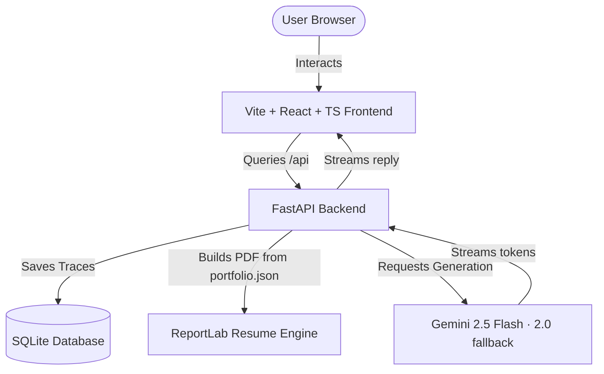

# 🌌 The Multi-Dimensional Universe of Hemanth

A premium, interactive, scroll-driven portfolio application that spans across multiple dimensions of professional capabilities, personal memories, and emotional journeys.

**🔗 Live: [portfolio-r2vv.onrender.com](https://portfolio-r2vv.onrender.com/)**

<div align="center">

[](https://vitejs.dev/)
[](https://reactjs.org/)
[](https://www.typescriptlang.org/)
[](https://fastapi.tiangolo.com/)
[](https://www.docker.com/)
[](https://deepmind.google/technologies/gemini/)

[](https://github.com/hemanthnagasai/Portfolio/actions/workflows/ci.yml)

</div>

---

## 🌌 The Four Dimensions

The site moves like Hemanth's own Instagram reels: full-bleed colour scenes cut on the beat, giant kinetic statements that slam in, and content on chunky playful cards. Five colours (cream, ink, orange, cobalt, lime), one face (Inter), hard offset shadows.

| Dimension | On the page | Core Features |
| :--- | :--- | :--- |
| **Gateway** | Cream hello, cobalt cards, an end card | Each world is a card; six dots fill in as you actually read each page, and a check appears once you've opened it. A locked fourth card reads ప్రవేశం లేదు and scans into NO ENTRY until it opens. Ends on the reels' sign-off. |
| **Professional** | Cobalt opening, then scenes | "DATA. CLARITY. INITIATIVE." slams in; numbered role cards, project cards, education scores that scramble into place, skills, certifications, résumé download. |
| **Personal** | Orange opening, then scenes | Story, hobby cards, a gallery of his own pencil sketches (tap to open full size), his singing reel (plays with sound on tap), and values shown as ~~struck word~~ then the word that beats it. |
| **Emotional** | Ink, and still | The letter, with only its title in motion, and a moderated guestbook ("Leave a Trace") where every word is a pill. |
| **Layer Zero** | Lime | Opens once all three worlds have been visited, or after 90 seconds. |

Moving between pages is the reels' cut: diagonal orange, ink and destination-colour bands sweep across.

A dedicated **Recruiter view** sits outside the four dimensions: a clean, fast, conversational summary of Hemanth's background with an AI chatbot that **streams replies token-by-token** (grounded in his real portfolio data), a one-click résumé PDF, and direct contact links. Each route also ships its own `<title>`/meta description and a JSON-LD `Person` schema for search and link previews.

---

## 🛠️ Architecture & Flow



---

## 🔒 Security & Moderation

This application includes robust security and content moderation features to prevent abuse, resource exhaustion, and spam:

- **AI-Driven Moderation:** Guestbook trace submissions are automatically validated by the Gemini API (`gemini-2.5-flash`) with a fast-path local profanity filter fallback to reject inappropriate content instantly.
- **Rate Limiting:** Protects AI generation quotas and server capacity using an IP-based sliding window rate limiter on key interaction endpoints.
- **Database Row Capping:** Automatically auto-prunes database tables during write operations to prevent disk space exhaustion from continuous spam.
- **Payload Constraints:** Enforces strict Pydantic length and validation constraints on client-supplied data inputs.
- **CORS Hardening:** Cross-origin requests are restricted to an explicit allowlist (configurable via `CORS_ORIGINS`), not left open to any origin.
- **Security Headers:** every response carries a strict Content-Security-Policy (`script-src 'self'`, extendable per-host via env), plus HSTS, `X-Frame-Options`, `X-Content-Type-Options`, `Referrer-Policy`, and `Permissions-Policy`.
- **Secure Admin Deletion:** A protected `DELETE /api/traces/{word}` endpoint is available for manual moderation, secured by a **constant-time** `ADMIN_TOKEN` header check, with deletions logged for accountability. Real client IPs are honored behind the platform proxy so rate limiting is per-visitor, not per-load-balancer.

---

## ⚡ Performance & Accessibility

- **Light by design:** no WebGL, no scroll hijacking, three font families (Inter, Anek Telugu for the Telugu sign, JetBrains Mono for SQL). Each world is a few kilobytes of JS on top of the shared bundle.
- **Reduced motion:** with the OS-level `prefers-reduced-motion` setting, statements and cards appear without slamming or springing, the marquees stop, and the page-change bands are skipped.
- **Code-split routes & stable vendor chunks:** each dimension loads its own JS chunk on demand, and Framer Motion is split into its own hashed chunk so editing app code doesn't force returning visitors to re-download it.
- **HTTP caching & compression:** content-hashed assets are served `immutable` for a year, HTML always revalidates, and responses are gzipped.
- **Keyboard & screen-reader support:** a visible focus ring on every interactive element, a skip-to-content link, `prefers-reduced-motion` throughout, and labelled navigation.
- **Streaming chat:** the Recruiter chatbot renders its reply token-by-token instead of blocking on the full generation.
- **Always warm:** a lightweight `/api/health` endpoint is pinged on a schedule (GitHub Actions) to keep the free-tier host from cold-starting between visitors.
- **Error boundary:** an unexpected render error shows a recoverable message instead of a blank screen.

---

## ⚙️ Setup & Local Development

### 📋 Prerequisites
- **Node.js** (v18+; CI uses 20)
- **Python** (v3.11+; CI and the production image run 3.13)
- **Gemini API Key** (Required for the interactive Recruiter chatbot)

---

### 1️⃣ Environment Configuration

Create a local environment configuration using the provided examples:

* **Backend**: Create a `backend/.env` file:
  ```env
  DB_NAME=portfolio
  GEMINI_API_KEY=your_gemini_api_key_here
  ADMIN_TOKEN=your_admin_token_here
  ```
* **Frontend**: Create a `frontend/.env` file:
  ```env
  PORT=5000
  HOST=0.0.0.0
  REACT_APP_BACKEND_URL=
  ```

#### Optional: error tracking & analytics

Both are **off by default** — the app ships no third-party code until these are set.

* **Sentry (error tracking).** Set the backend var (runtime) and/or the frontend var (build-time):
  ```env
  # backend/.env
  SENTRY_DSN=https://<key>@<org>.ingest.sentry.io/<project>
  # frontend/.env  (inlined at build — rebuild after changing)
  REACT_APP_SENTRY_DSN=https://<key>@<org>.ingest.sentry.io/<project>
  ```
* **GoatCounter (privacy-friendly, cookieless analytics).** Frontend build-time var, set to your counter URL:
  ```env
  # frontend/.env
  REACT_APP_GOATCOUNTER=https://<yourcode>.goatcounter.com/count
  ```
* **CSP allowances.** The strict Content-Security-Policy blocks these hosts by default. When enabling either, open the matching directive via space-separated backend env vars:
  ```env
  # backend/.env
  CSP_CONNECT_EXTRA=https://*.sentry.io https://<yourcode>.goatcounter.com
  CSP_SCRIPT_EXTRA=https://gc.zgo.at
  ```

> Frontend `REACT_APP_*` vars are inlined at build time (Vite), so on a host like Render, set them in the service's environment and trigger a rebuild. Backend vars take effect on restart.

---

### 2️⃣ Backend Server Installation (FastAPI)

From the `backend/` directory:

1. **Initialize and Activate Virtual Environment**:
   ```bash
   python -m venv .venv
   
   # Windows PowerShell
   .\.venv\Scripts\Activate.ps1
   
   # macOS / Linux
   source .venv/bin/activate
   ```
2. **Install Dependencies**:
   ```bash
   pip install -r requirements.txt
   ```
3. **Launch Server**:
   ```bash
   python -m uvicorn app.main:app --host localhost --port 8000 --reload
   ```

> [!NOTE]
> The local API Documentation is available at `http://localhost:8000/docs`.

---

### 3️⃣ Frontend Development Setup (Vite + React)

From the `frontend/` directory:

1. **Install Dependencies**:
   ```bash
   npm install
   ```
2. **Launch Dev Server**:
   ```bash
   npm run start
   ```

> [!TIP]
> The frontend will load at `http://localhost:5000/`. Vite will automatically proxy API requests to port `8000` locally.

---

## 🐳 Docker Deployment (Production)

You can run the entire application (serving the built frontend through FastAPI) from a single container:

1. **Build Image**:
   ```bash
   docker build -t life-portfolio .
   ```
2. **Launch Container**:
   ```bash
   docker run -d -p 8000:8000 -e DB_NAME="portfolio" -e GEMINI_API_KEY="your_api_key" -e ADMIN_TOKEN="your_admin_token" life-portfolio
   ```

Open `http://localhost:8000` to view the live app.

---

## 🧪 Running Tests

Continuous integration runs **four jobs** on every push/PR (see the CI badge above):

| Job | What it checks |
| :--- | :--- |
| **Backend tests** | `pytest`, with all external calls (Gemini, etc.) mocked — fully offline and deterministic, no API key or quota needed. |
| **Frontend typecheck & build** | `tsc --noEmit` plus a production Vite build. |
| **E2E smoke tests** | Playwright drives the real rendered app (served by the backend, production-shape) through its key flows — landing, world navigation, chat widget, résumé endpoint, admin console. |
| **Docker image smoke test** | Builds the **actual production image**, runs the container, and verifies the endpoints serve (health, résumé PDF, SPA shell) — catches "works in source, broken in the image" bugs the other jobs can't see. |

Run locally:

```bash
# Backend unit tests — from backend/
.\.venv\Scripts\pytest         # Windows PowerShell
pytest                          # macOS / Linux (venv activated)

# End-to-end — from frontend/ (builds the app, boots it, drives a browser)
npm run test:e2e
```
